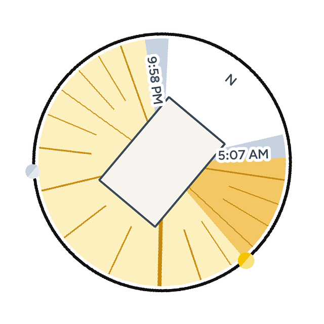
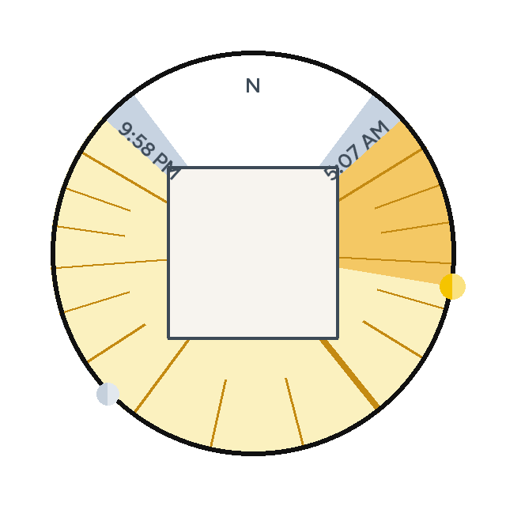

<picture>
  <source media="(prefers-color-scheme: dark)" srcset="custom_components/sun_sweep/brand/dark_logo@2x.png">
  
</picture>

# Sun Sweep

A Home Assistant card that looks straight down on your house and draws the
angles the sun reaches today. The building outline comes from
[House Structure](https://github.com/minchinweb/ha-house-structure), which
reads it from OpenStreetMap. Without House Structure the card draws a 10 m
square instead.

A black ring circles the disc, and the wedges run out to it. North sits just
inside it. Pale yellow is every compass direction the sun passes while it is
up. A stronger yellow runs from sunrise to where the sun is now. Blue-grey
shoulders on either side are civil twilight. Sunrise and sunset sit just
outside those two edges, each edge the baseline of its time. Hour lines mark
each clock hour the sun is up: noon runs to the centre and is drawn heavier
than the three-hour lines, and every third hour reaches further in than the
hours between. The house is drawn on top, so the lines stop at the walls, and
the heavy noon spoke is still the one that stands out. The sun
and the moon are two-tone discs centred on the ring, each only while that
body is above the horizon.

The pictures below are the card's own drawing for Edmonton. The first three,
and the turned one, use a plain rectangle in place of a footprint. On your
dashboard the polygon is the building OpenStreetMap has at your home
coordinates, or the square when House Structure is not installed.

A mid-morning in June. Twilight is the blue-grey on either side of the day.
The stronger yellow is the part already past, and the sun rides the ring at
that boundary. Noon is the spoke through the house.


A winter afternoon. The daylight is the short southern arc, with twilight
either side, and most of it is already swept.


After sunset the whole wedge stays, fully swept, and the sun is gone. The
moon is on the ring only because it is still up.


The same June morning, turned 40 degrees clockwise (`rotation: 40`). North
turns with the house.



The same morning again, with the 10 m square the card draws when House
Structure is not installed.



## Installation

House Structure is optional. Install it when you want the real building
instead of a 10 m square. Sun Sweep sets up either way, and uses the
outline once House Structure has found the building at your home position.
Sun Sweep does not call OpenStreetMap itself.

[](https://my.home-assistant.io/redirect/marketplace_repository/?owner=minchinweb&repository=ha-sunsweep-card&category=integration)

1. Click the button above. It opens this repository in the Marketplace
   (**Settings > Marketplace**, Home Assistant 2026.11 and later). By hand:
   choose **Add from link** and enter
   `https://github.com/minchinweb/ha-sunsweep-card`.
2. Click **Install**. Restart Home Assistant if the Marketplace says to.
3. Add the integration:

   [](https://my.home-assistant.io/redirect/config_flow_start/?domain=sun_sweep)

Before Home Assistant 2026.11, install it with
[HACS](https://my.home-assistant.io/redirect/hacs_repository/?owner=minchinweb&repository=ha-sunsweep-card&category=integration)
instead. Without either, copy `custom_components/sun_sweep/` into Home
Assistant's `custom_components/` folder and restart.

It needs Home Assistant 2025.3 or later, the same as House Structure. Adding
it creates `sensor.sun_sweep`, plus `Sunrise azimuth` and `Sunset azimuth`
on the same device. The card reads `sensor.sun_sweep`.

Setting up the card, and what each toggle does, is in
[the configuration page](docs/configuration.md). That is the page Home
Assistant opens from the integration's help view.

## The card

```yaml
type: custom:sun-sweep-card
entity: sensor.sun_sweep
show_sun: true
show_times: true
show_moon: true
show_hours: true
show_twilight: true
```

To turn the card, or to hold it on one moment for a screenshot:

```yaml
type: custom:sun-sweep-card
rotation: 40
date: march-equinox
time: "09:30"
```

The toggles default on. `rotation` defaults to 0, and leaving `date` out
keeps the card on the live clock. The visual editor has the same controls.

| Toggle | Draws |
| --- | --- |
| Sun | The two-tone yellow disc on the ring, while the sun is above the horizon |
| Sunrise and sunset | Those clock times written along the two edges of the wedge |
| Moon | The two-tone disc on the ring, while the moon is above the horizon |
| Hour lines | A line at each local hour the sun is up. Noon reaches the centre, and every third hour is longer, but the house covers whatever falls inside the walls |
| Twilight | A blue-grey wedge from civil dawn to civil dusk, under the daylight |
| Rotation | Degrees clockwise to turn the whole card. North stays the geographic north of the drawing |
| Date and time | Pin the drawing to `YYYY-MM-DD`, an equinox (`march-equinox`, `september-equinox`), or a solstice (`june-solstice`, `december-solstice`), and an optional `HH:MM`. `spring`, `summer`, `autumn`, and `winter` follow the home hemisphere. The sensor stays on the live clock. The card says which day it is holding |
| Tap action | What a tap does. The default, `none`, leaves the picture alone |
