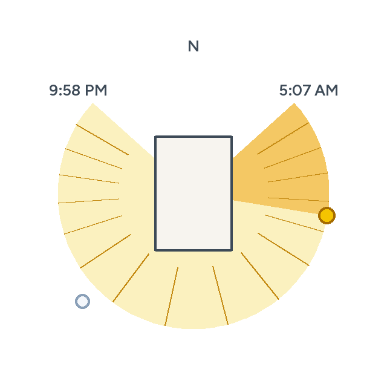
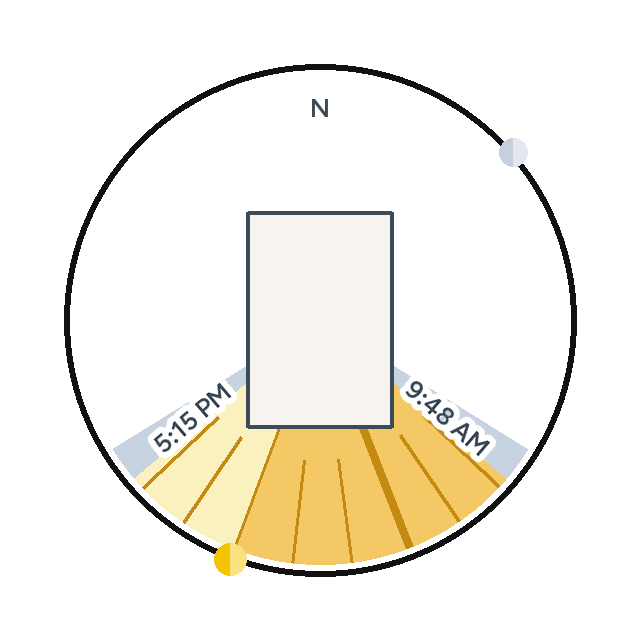
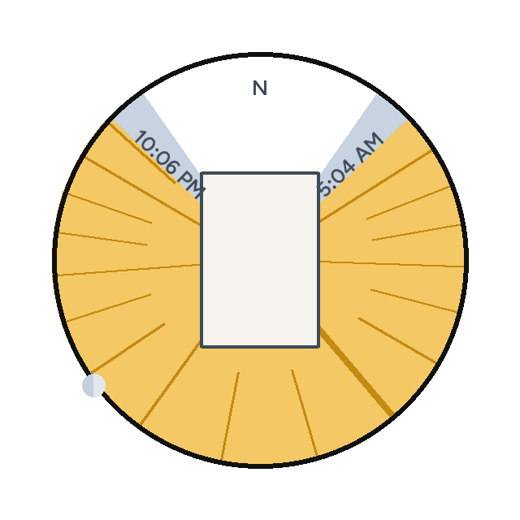

<picture>
  <source media="(prefers-color-scheme: dark)" srcset="custom_components/sun_sweep/brand/dark_logo@2x.png">
  
</picture>

# Sun Sweep

A Home Assistant card that looks straight down on your house and draws the
angles the sun reaches today. The building outline comes from
[House Structure](https://github.com/minchinweb/ha-house-structure), which
reads it from OpenStreetMap. Without House Structure the card draws a 10 m
square instead. The yellow wedge is every compass direction the
sun passes while it is up. A stronger yellow runs from sunrise to where the
sun is now. Hour lines mark each clock hour. The sun and the moon are
two-tone discs centred on the black ring, each only while that body is above
the horizon.

A black ring circles the disc. North is up. The house is your building, not a generic box: House Structure
fetches the footprint (Nominatim, then Overpass) and Sun Sweep reads the ring
it keeps.

The pictures below are the card's own drawing for a house in Edmonton, with a
plain rectangle standing in for the footprint. On your dashboard the polygon
is the building OpenStreetMap has at your home coordinates.

A mid-morning in June. The stronger yellow is the part of the day already
past; the sun rides the ring at the boundary.



A winter afternoon. The wedge is the short southern arc.



After sunset the whole wedge stays, fully swept, and the sun is gone. The
moon is drawn only because it is still up.



## Installation

House Structure is optional. Install it when you want the real building
instead of a 10 m square, and let it find the building at your home position
first. Sun Sweep does not call OpenStreetMap itself.

[](https://my.home-assistant.io/redirect/marketplace_repository/?owner=minchinweb&repository=ha-sunsweep-card&category=integration)

1. Click the button above. It opens this repository in the Marketplace
   (**Settings > Marketplace**, Home Assistant 2026.11 and later). By hand:
   choose **Add from link** and enter
   `https://github.com/minchinweb/ha-sunsweep-card`.
2. Click **Install**. Restart Home Assistant if the Marketplace says to.
3. Add the integration:

   [](https://my.home-assistant.io/redirect/config_flow_start/?domain=sun_sweep)

Before Home Assistant 2026.11, install it with
[HACS](https://my.home-assistant.io/redirect/hacs_repository/?owner=minchinweb&repository=ha-sunsweep-card&category=integration)
instead. Without either, copy `custom_components/sun_sweep/` into Home
Assistant's `custom_components/` folder and restart.

It needs Home Assistant 2025.3 or later, the same as House Structure. Adding
it creates `sensor.sun_sweep`. The card reads that sensor.

Setting up the card, and what each toggle does, is in
[the configuration page](docs/configuration.md). That is the page Home
Assistant opens from the integration's help view.

## The card

```yaml
type: custom:sun-sweep-card
entity: sensor.sun_sweep
show_sun: true
show_times: true
show_moon: true
show_hours: true
show_twilight: true
```

The toggles default on. The visual editor has the same switches.

| Toggle | Draws |
| --- | --- |
| Sun | The two-tone yellow disc on the ring, while the sun is above the horizon |
| Sunrise and sunset | Those clock times written along the two edges of the wedge |
| Moon | The two-tone disc on the ring, while the moon is above the horizon |
| Hour lines | A line at each local hour the sun is up. Noon reaches the centre; every third hour is longer than the hours between |
| Twilight | A blue-grey wedge from civil dawn to civil dusk, under the daylight |
| Rotation | Degrees clockwise to turn the whole card. North stays the geographic north of the drawing |
| Date and time | Pin the drawing to `YYYY-MM-DD` and an optional `HH:MM`, for a screenshot or while checking a day. The sensor stays on the live clock |
